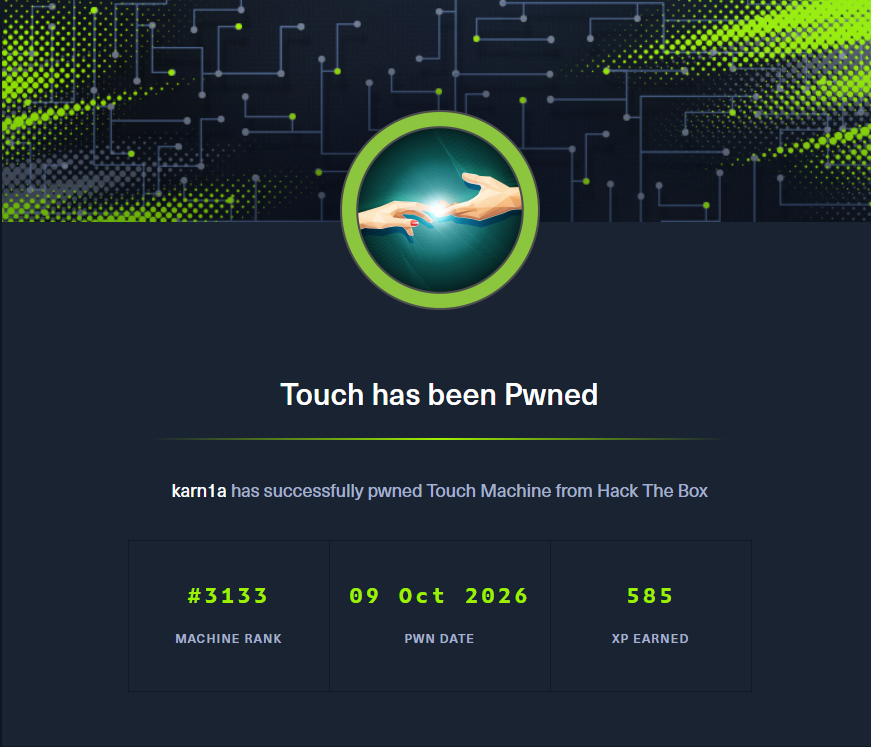

# Enumeration

## Nmap Enumeration

```bash
nmap -p 135,3389,5985,8443 -sVC -O  -Pn 10.129.46.199 --min-rate=2000 -oN nmap_scan
Starting Nmap 7.95 ( https://nmap.org ) at 2026-10-07 15:53 IST
Nmap scan report for 10.129.46.199
Host is up (0.066s latency).

PORT     STATE SERVICE       VERSION
135/tcp  open  msrpc         Microsoft Windows RPC
3389/tcp open  ms-wbt-server Microsoft Terminal Service
5985/tcp open  http          Microsoft HTTPAPI httpd 2.0 (SSDP/UPnP)
|_http-title: Not Found
|_http-server-header: Microsoft-HTTPAPI/2.0
8443/tcp open  http          Microsoft HTTPAPI httpd 2.0 (SSDP/UPnP)
|_http-cors: GET POST PUT OPTIONS
| http-title: Nexion DeviceHub - Login
|_Requested resource was /login
|_http-server-header: Microsoft-HTTPAPI/2.0
|_http-trane-info: Problem with XML parsing of /evox/about
Warning: OSScan results may be unreliable because we could not find at least 1 open and 1 closed port
Device type: general purpose
Running (JUST GUESSING): Microsoft Windows 11|2008|7 (88%)
OS CPE: cpe:/o:microsoft:windows_11 cpe:/o:microsoft:windows_server_2008:r2 cpe:/o:microsoft:windows_7
Aggressive OS guesses: Microsoft Windows 11 21H2 (88%), Microsoft Windows 7 or Windows Server 2008 R2 (85%)
No exact OS matches for host (test conditions non-ideal).
Service Info: OS: Windows; CPE: cpe:/o:microsoft:windows
```

From the nmap scan, we can see:- RPC services on port 135, RDP on 3389, and HTTP servers on ports on 5985 and 8443

*This box is still active on HackTheBox. Once retired, this writeup will be published for public access as per HackTheBox's policy on publishing content from their platform*
